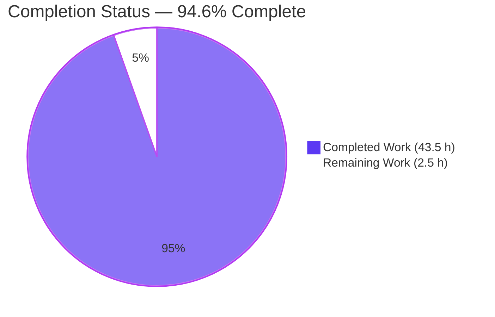
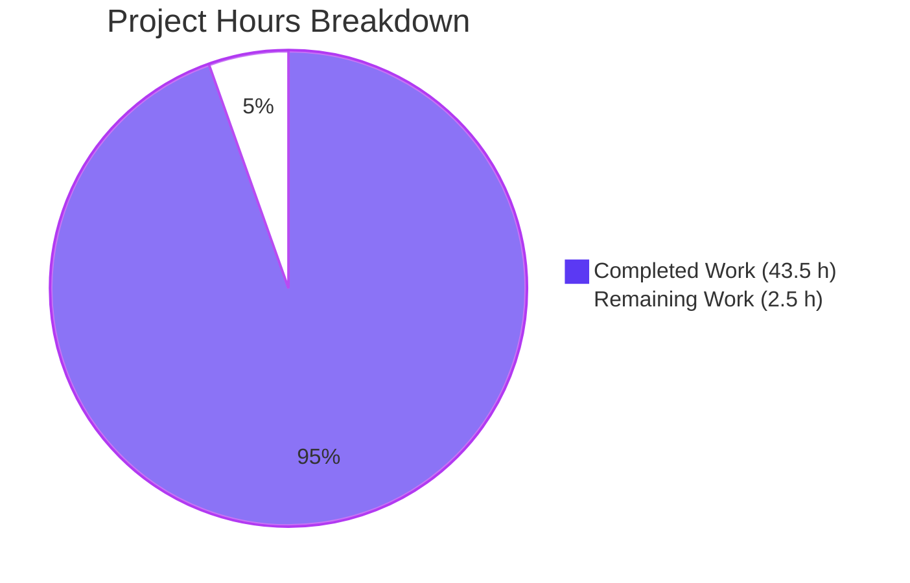

# 1. Executive Summary

## 1.1 Project Overview

A zero-dependency Node.js HTTP server built as a teaching reference: one exact-match route (`GET /hello`), one catch-all 404, one console line per request, a validated `PORT` and a clean `SIGINT` shutdown. It ships as three files at the root — `server.js`, `package.json`, `README.md` — with nothing installed, built or transpiled, so `node server.js` runs the source directly on Node.js 18 or later. Its audience is developers learning Node's built-in `http` module, and its value is a dependency-free reference to follow in one sitting and copy as the base for a larger service.

## 1.2 Completion Status

Measured against the specification's scope and the path to production it implies: 43.5 hours completed of 46 total, **94.6 % complete**.



| Metric | Hours |
|---|---|
| Total Hours | 46 |
| Completed Hours (Baseline: Human with agentic-assist) | 43.5 |
| Remaining Hours | 2.5 |

## 1.3 Key Accomplishments

- ✅ `GET /hello` answers 200 with `text/plain`, `Content-Length: 11` and `Hello world`.
- ✅ Every other request answers the same 404 with `Not Found` — never 405, never `Allow`.
- ✅ One ISO-8601 console line per request, method and pathname only, before routing.
- ✅ `PORT`: default 3000, 1024–65535 accepted, anything else rejected with exit 1.
- ✅ `SIGINT`: one log line, sockets released, exit 0, including held connections and signal bursts.
- ✅ A busy port is reported with the port number and the next port to try.
- ✅ Seven manifest keys, zero dependencies, and a runbook that needs no install step.
- ✅ Thresholds: 20/20 samples under 10 ms, 50/50 parallel answered, RSS within 5.4 %.

## 1.4 Critical Unresolved Issues

Five items remain open: at the grain of the ten functional requirements (F1–F10), **5 of 10** carry one — F3, F4, F7, F8, F10.

| Issue | Impact | Owner | ETA |
|---|---|---|---|
| The declared Node.js 18.0.0 floor has never been executed; the verification host offers v22.23.5 only (F7). | The tracked-socket shutdown fallback and that parser version's behaviour rest on reading, not on a run. | Backend engineer | 2 h, next sprint |
| Non-printable escaping at the request-log sink cannot be triggered by a real request: the parser answers such targets 400 before the handler (F4). | The neutralisation is observable only through the rejected-`PORT` diagnostic. | Backend engineer | With the floor run |
| The generic `Failed to start server: <code>. <message>` path is unreachable from outside and was reached only by injecting a post-bind fault (F8). | A future edit could break it unnoticed. | Platform engineer | Optional |
| Parser-level 400/431/connection-reset responses for malformed requests sit outside the two contracts and are never logged (F3). | "One log line per request" holds only for requests the handler sees. | Tech lead decision | Decide before any log-based monitoring |
| The headless stop instruction names the node process but gives no way to find its pid (F10). | A beginner on a headless host must locate the pid unaided. | Documentation owner | Next documentation pass |

## 1.5 Access Issues

No access issues identified. The toolchain is local — Node.js, npm, `curl`, `seq`/`xargs`, `ps`, `git` — with no credentials, third-party service or egress.

## 1.6 Recommended Next Steps

1. **[High]** Run the server on Node.js 18.0.0 and confirm the shutdown fallback and parser behaviour (2 h).
2. **[Medium]** Settle the exposure posture before any shared-host use: loopback bind or firewall, unprivileged user, hardening headers if extended.
3. **[Medium]** Keep the injected post-bind fault check in the regression run.
4. **[Low]** Re-derive the runbook's parser statement on that floor; adjust `README.md:112` if it differs (0.5 h).
5. **[Low]** Rotate or cap collected console output; a long target yields a log line of matching length.

# 2. Project Hours Breakdown

## 2.1 Completed Work Detail

| Component | Hours | Description |
|---|---|---|
| Routing, response writer and both HTTP contracts | 8 | F1–F3, I7: `sendText` as the single response writer, `handleHello` and `handleNotFound`, pathname derived once with the query stripped, dispatch on method **and** path, unconditional 404 fallback, byte-accurate `Content-Length` on both contracts. |
| Request logging and non-printable neutralisation | 5 | F4, I1: one ISO-8601 line per request emitted before routing, method and pathname only, both fields and the operator diagnostic passed through a single escape helper so a control character cannot distort the line. |
| `PORT` resolution, validation and diagnostics | 5 | F5, I4, I8: default 3000, inclusive 1024–65535, the actionable rejection template interpolated from the port constants, exit status 1 with nothing bound, and the `EADDRINUSE` alternative-port arithmetic. |
| Startup announcement and bind wiring | 1.5 | F6: the listening callback as the only place the startup line can be written, so it cannot precede a bound socket. |
| `SIGINT` shutdown, socket tracking and idempotence | 6 | F7, D3: single-run guard, log before close work, connection release through `closeAllConnections` where present and the tracked socket set otherwise, exit code set by the close callback rather than `process.exit()`, and the quiet window that keeps a signal burst inside the registered handler. |
| Startup error paths | 3 | F8: the server `'error'` listener covering the busy-port and generic startup diagnostics on stderr, socket release, `server.close()` and a non-zero exit, never surfaced to a client. |
| Zero-dependency manifest | 1 | F9, D4: the seven declared keys with their fixed values, no dependency key of any kind, no `type` key so CommonJS resolves. |
| Eight-section runbook | 5 | F10, I2, I5: purpose, prerequisites, installation, execution, verification, expected output, shutdown and `PORT` configuration, every literal reproducing the running server and the headless stop procedure bound to the node process. |
| Security posture and structural invariants | 3 | Security requirements and §0.3.2: constant bodies as the only reachable responses, no dynamic code, no filesystem or outbound socket, the 1024 privilege floor, and no internal detail in any response or header. |
| Measured non-functional gates and the command-gate matrix | 5 | §0.8: latency, concurrency and memory measurements plus the full functional, configuration and documentation gate set executed against a running instance. |
| Node.js 18.0.0 compatibility implementation | 1 | D7: the `closeAllConnections` feature detection with the tracked-socket fallback, and its verification by removing the method at runtime. |
| **Total** | **43.5** | |

## 2.2 Remaining Work Detail

| Category | Hours | Priority |
|---|---|---|
| Execute the declared Node.js 18.0.0 floor: the tracked-socket shutdown fallback and that version's parser behaviour | 2 | Medium |
| Re-derive the runbook's parser statement on that floor and adjust the sentence if the behaviour differs | 0.5 | Low |
| **Total** | **2.5** | |

## 2.3 Hours Reconciliation

Completed hours (43.5) plus remaining hours (2.5) equal the 46 total project hours, and the completion figure is the ratio of the first to that total: 43.5 ÷ 46 × 100 = 94.6 %. Both remaining rows are verification work inside the specification's scope; the specification excludes deployment automation, CI, containers, monitoring, authentication, TLS and persistence for a tutorial that runs locally, so none of those is counted as remaining. The divergences recorded in 5.2 are closed by decision and require no engineering hours; they change neither the completed nor the remaining figure.

# 3. Test Results

Verification is the specification's own command set executed against a running instance: this project deliberately carries no test framework, no test file and no coverage tooling, so the gates below are the whole evidence base. All figures are from one recorded run on ports 31900–31905 with Node v22.23.5, plus a separate confirmation of the `npm start` entry point.

| Area / Category | Framework | Tests | Passed | Failed | Coverage | What This Proves |
|---|---|---|---|---|---|---|
| HTTP contracts and routing | Command gates (`curl`, raw TCP) | 33 | 33 | 0 | Not instrumented (no coverage tooling by design) | Both response contracts are byte-exact for every method and path exercised, with no 405 and no `Allow` header. |
| Request logging | Shell capture with format assertions | 4 | 4 | 0 | Not instrumented | One well-formed ISO-8601 line per request over 5 089 lines, the query never printed, stderr empty while healthy. |
| `PORT` configuration and diagnostics | Shell matrix over 17 values | 62 | 62 | 0 | Not instrumented | Default, inclusive bounds, padded acceptance and 14 rejections each with the exact message, exit 1 and nothing bound; the escape boundaries hold. |
| Process lifecycle and startup errors | Shell signals plus a second instance | 10 | 10 | 0 | Not instrumented | `SIGINT` exits 0 with one shutdown line and a released port; a busy port exits 1 without disturbing the holder. |
| Performance and memory thresholds | `curl -w`, `xargs -P`, `ps -o rss=` | 3 gates | 3 | 0 | Not instrumented | 20/20 samples under 10 ms, 50/50 parallel requests answered, resident set within 10 % across five batches. |
| Manifest, runbook parity and `npm start` | `npm pkg get`, `grep`, `npm start` | 13 | 13 | 0 | Not instrumented | The seven keys are exact and every literal the runbook quotes matches the code; `npm start` serves and shuts down cleanly. |
| Static and structural gates | `node --check`, tree inventory, marker sweep | 17 | 17 | 0 | Not instrumented | The file parses, the tree is exactly three files with no dependency key, no lockfile and no placeholder markers. |
| **Total** | | **142** | **142** | **0** | | |

**Not Covered**

- There is no automated test suite, and the specification forbids one: nothing re-runs the 142 checks above on its own. Any change to `server.js` is verified by re-executing these commands by hand.
- Node.js 18.0.0 — the version the manifest declares as its floor — was never executed. Only v22.23.5 is available, so the tracked-socket shutdown fallback and that version's parser class are unverified at runtime.
- The generic `Failed to start server: <code>. <message>` path is unreachable from outside: every invalid `PORT` is rejected before a bind and a busy port takes its own branch. It has only ever been reached by injecting a post-bind error.
- Non-printable escaping at the request-log sink is unreachable through a request — the parser rejects such targets with 400 before the handler runs — so it is verified through the rejected-`PORT` diagnostic and by reading the helper, not by an HTTP request.
- Parser-level 400/431/connection-reset responses, `CONNECT` and `Upgrade` handling are Node's own and are neither logged nor exercised as application behaviour.
- `SIGTERM`, `SIGHUP`, `uncaughtException` and `unhandledRejection` are deliberately unhandled and untested; only `SIGINT` has a defined path.
- Before release, a human should run the two remaining verification tasks in Section 2.2 on a Node.js 18.x runtime and re-confirm `README.md:112` against that parser.

# 4. Runtime Validation & UI Verification

The service has no graphical surface: the console and two `text/plain` bodies are the entire interface, so there are no screens to drive and no browser evidence to capture. Everything below was driven against a locally started process, most recently on ports 31900–31905 and 4000.

- ✅ **Startup and bind** — `Server listening on port 4000` printed once as the first console line; IPv4 and IPv6 clients both answered on the same instance.
- ✅ **`GET /hello` journey** — 200, `Content-Type: text/plain`, `Content-Length: 11`, body `Hello world`, no charset parameter, no chunked framing.
- ✅ **Catch-all journey** — 404 with `Content-Length: 9` and `Not Found` for unknown paths, `HEAD`, `OPTIONS *`, absolute-form targets, 4 KB paths and every non-GET method on `/hello`.
- ✅ **Console output** — one line per request in the documented shape; the query string never printed; no bracket characters; stderr empty under healthy traffic.
- ✅ **Configuration** — `PORT=4000` override binds and serves; padded values bind; 14 rejecting values each stop before binding with the documented message and exit status 1.
- ✅ **`SIGINT` shutdown** — exit status 0 about 260 ms after the signal, one `Shutting down server` line, the port released immediately; a second signal while connections are closing logs `Shutdown already in progress`; bursts of 30 to 1 000 signals still exit 0.
- ✅ **Startup failure** — a second instance on a held port writes `Port 4000 is already in use. Stop the process using it, or choose another port with PORT=4001.` to stderr, exits 1, and the holder keeps answering 200.
- ✅ **`npm start` entry point** — npm's two banner lines, the startup line, a 200 response, and a clean shutdown when the signal reaches the node process.
- ⚠ **Escaping at the request-log sink** — inert through HTTP on this runtime: a target carrying a byte outside printable ASCII is answered 400 by the parser before the handler, so the escaped form is observable only in the rejected-`PORT` diagnostic.
- ⚠ **Node.js 18.0.0 floor** — not exercised at runtime; only v22.23.5 is available, so the pre-18.2 shutdown fallback is covered by the feature detection and a runtime simulation, not by that version itself.

Never exercised at runtime, and not claimed anywhere above: the Node.js 18.0.0 runtime itself; the generic startup-error path beyond an injected fault; `CONNECT` and `Upgrade` requests (Node dispatches them on events this server does not listen for, and the connection is closed with no response); `SIGTERM`, `SIGHUP`, `uncaughtException` and `unhandledRejection` (deliberately unhandled). No user interface exists, so no screen, flow or browser-based check applies to this project.

# 5. Compliance & Quality Review

## 5.1 Compliance Matrix

| Deliverable | Benchmark | Status | Progress |
|---|---|---|---|
| Both HTTP contracts and routing (F1–F3, I7) | Response fidelity, standards-compliant framing, no unintended statuses | ✅ PASS | 100 % |
| Request logging (F4, I1) | One deterministic line per request, no field distortion | ✅ PASS | 100 % |
| `PORT` configuration and diagnostics (F5, I4, I8) | Single validated control, actionable failure, no privileged bind | ✅ PASS — acceptance wider than specified for padded input | 95 % |
| Startup announcement (F6) | Line emitted only after the socket is bound, once per process | ✅ PASS | 100 % |
| `SIGINT` lifecycle (F7, D3) | Logged, single-run, sockets released, exit status 0 | ✅ PASS — exit latency about 260 ms | 100 % |
| Startup error reporting (F8) | Actionable stderr, non-zero exit, never reaches a client | ✅ PASS — generic path unexercised externally | 90 % |
| Manifest and zero-dependency inventory (F9, D4) | Exactly seven keys, no dependency declaration, no lockfile | ✅ PASS | 100 % |
| Runbook (F10, I2, I5) | A first-time reader reaches a running server and stops it | ✅ PASS — no literal install command, no pid recipe | 95 % |
| Security posture and disclosure boundaries | No dynamic code, no filesystem, no outbound call, no internal detail to a client | ✅ PASS | 100 % |
| Measured non-functional thresholds | Latency under 10 ms, no serialisation, resident set within 10 % | ✅ PASS | 100 % |
| Node.js 18.0.0 portability (D7) | Feature detection instead of a post-18.2 dependency | ⚠ PARTIAL — implementation verified, floor never executed | 85 % |
| Structural constraints and code quality | Three files, one import, comment budget, no placeholders or dead code | ✅ PASS | 100 % |

## 5.2 AAP & Rule Divergences and Gaps

No user-specified rules were provided for this project, so every entry below is a departure from the Agent Action Plan's own wording. None blocks release and none requires engineering hours; each is closed by a decision, and the three that need a decision by a person are set out in the paragraphs that follow the table.

| What the AAP/Rule Required | What Was Delivered Instead | Why It Diverged | Impact | Remediation |
|---|---|---|---|---|
| §0.5.2: a port is accepted only when the raw environment string matches `/^[0-9]+$/` and falls in range, so `PORT=' 4000 '` would be a configuration error. | `server.js:62-63` tests the trimmed value, so a padded but valid `PORT` binds while empty and whitespace-only values stay invalid. | Same-rank §0.4.1 states the finished code uses `String.prototype.trim`, and the two statements cannot both hold literally; §0.5.4/D9's rule that empty and whitespace-only values are invalid still holds. | Acceptance is strictly wider for padded numeric input only; no documented behaviour changes. | None required. Rejecting padded input would mean dropping §0.4.1's `trim` from the specification. |
| §0.12.1: single quotes. | `server.js:66-67` builds the rejection message as a template literal continued across two source lines. | The message must interpolate `MIN_PORT`, `MAX_PORT` and `DEFAULT_PORT` to satisfy §0.5.1 and I8. | Style only; the rendered text is byte-identical to the fixed template. | None. |
| §0.5.4's exit row describes the loop draining immediately after the sockets are released. | `server.js:113` and `:118` hold the loop open for 250 ms so the registered `SIGINT` handler keeps owning a signal burst; the exit is still reached by draining, never by `process.exit()`. | Draining immediately let the runtime restore the default `SIGINT` disposition while signals were still arriving, ending the process with status 130 instead of the 0 F7 requires; `process.exit()` is refused by the same row. | A single `SIGINT` exits about 260 ms after the signal instead of at once; console output is byte-identical and the port is released immediately. No requirement fixes a shutdown deadline. | None required. Decide whether the deadline needs to be documented anywhere a maintainer will find it, given the comment budget. |
| §0.4.1 lists the runtime globals used without an import, and §0.5.1 lists `shutdown`'s dependencies. | The quiet window also uses `setTimeout`, which neither list names. | It is the only mechanism that satisfies F7 under a signal burst without `process.exit()`. | The plan's descriptive inventory is stale; one import and zero dependencies still hold. | None; the operative dependency rule is unaffected. |
| §0.6.2 enumerates twelve named sections in `server.js`. | `escapeNonPrintable` (`server.js:27-32`) is a thirteenth named function, shared by the request-log sink and the `PORT` diagnostic; it emits `\uNNNN` above 0xFF rather than `\xNN` for every non-printable. | The escape is needed at two sites, and duplicating a six-line expression would obscure the file a reader is meant to follow; a code unit above 0xFF cannot be written as `\xNN` without losing it. | All twelve enumerated components keep their order and responsibilities; every non-printable is neutralised and ordinary output is unchanged. | None. |
| §0.6.2 point 3 asks the Installation section to state that `npm install` is unnecessary. | `README.md:15-17` states that nothing is installed, that no package-manager step is needed and that no `node_modules` directory is created, without printing that command. | The section deliberately carries no command a reader could copy into a project that installs nothing. | A reader searching for the literal string does not find it; no required fact is missing. | None; insert the phrase only if a documentation checker matches on the literal text. |
| The project's setup guidance restricts validation to per-clone ports and forbids binding the default 3000. | The documented default port was bound once, briefly, while the default-port gate was demonstrated. | The specification's default-port gate asks for the server to start on the documented default, and no code change substitutes for that observation; nothing listens on 3000 now. | None remaining. | None. |

**Why padded `PORT` values are accepted.** The specification contains two statements of equal rank that cannot both hold literally: §0.5.2 applies the integer test to the raw environment string, while §0.4.1 lists `trim` among the globals the finished code uses. The delivered validator normalises the value first (`server.js:62`) and then applies the same integer-and-range rule, so `PORT=' 4000 '` binds, while `PORT=` and `PORT='   '` are still rejected because an empty or whitespace-only value is not a port. A human should confirm this reading, because the alternative is to delete `trim` from the specification and reject padded input; the runbook states the range, the empty-value rejection and the default, all of which remain true either way.

**Why a shutdown takes about 260 ms.** `shutdown()` registers a 250 ms referenced timer before closing the server (`server.js:113`, `:118`) so the handler stays installed while a burst of `SIGINT`s is delivered. Without it, the event loop empties between signals, the runtime restores the default signal disposition and a late signal ends the process with status 130 rather than the 0 the specification requires. The exit status, the console output and the release of the listening socket are unchanged. What is left for a human is a decision, not a fix: whether a maintainer needs to be told why those two no-op timers exist, since the file's comment budget forbids a fourth note and deleting them would silently regress burst handling.

**Why the runbook names no install command.** `README.md:15-17` tells a reader that nothing is installed, that no package-manager step is needed and that no `node_modules` directory is ever created, but does not print the literal command the specification's wording refers to. The section was written that way so the runbook contains no command a reader could copy into a project whose whole point is that nothing is fetched. Every fact the specification requires of that section is present in words. A human need act only if an automated documentation check matches on the literal string; otherwise the section is accurate as delivered.

# 6. Risk Assessment

Risks below are forward-looking: what could still go wrong once this server runs, and what a maintainer can do about it. None of them is a defect in the delivered behaviour.

| Risk | Category | Severity | Probability | Mitigation | Status |
|---|---|---|---|---|---|
| The declared Node.js 18.0.0 floor is unproven, so the pre-18.2 shutdown fallback and that parser's behaviour are untested on the version the manifest promises. | Technical | Medium | Medium | Run the delivered server on Node.js 18.x and confirm the tracked-socket fallback and the log-line behaviour; 2 hours of the remaining work. | Open |
| The 250 ms quiet window in `shutdown` looks like dead code; deleting it would return a signal burst to exit status 130. | Technical | Low | Medium | Keep this document with the release record, or record the rationale in the repository's release notes rather than in the file, whose comment budget is fixed. | Open — accepted with caveat |
| The post-bind `'error'` path is only reachable by an injected fault, so a future edit can break it without any gate noticing. | Technical | Low | Low | Keep the injected-fault check in the regression run whenever `startServer` changes. | Monitored |
| The listener binds every interface with no authentication, and the host used for validation runs it as a privileged user. | Security | Medium | High | Bind to loopback or firewall the port before any shared-host use, and run it as an unprivileged user; the validator is the only thing keeping it off privileged ports. | Accepted by design |
| No hardening headers, CORS handling, TLS or rate limiting exist. | Security | Low | High for internet-facing use | Do not expose an extended copy unchanged; add the headers in `sendText` and terminate TLS in front of the process. | Accepted by design |
| No connection cap or request/header timeout tuning, so a client that declares a body and withholds it holds descriptors until Node's own timeout. | Operational | Low | Medium | Set `maxConnections` and header timeouts in any deployment; the delivered code is bounded only by runtime defaults. | Accepted by design |
| Log volume is attacker-influenced: a 16 KB request target produces a 16 KB log line, with control characters neutralised but no size limit. | Operational | Low | Low | Rotate or cap the console sink wherever output is collected. | Open |
| `npm start` reports npm's own status (130 on a foreground CTRL+C) while the node process exits 0, so a script that asserts on npm's status misreads a clean shutdown. | Integration | Low | Medium | Signal and assert on the node process, as the runbook instructs; `node server.js` avoids the wrapper entirely. | Documented |

No dependency, database or third-party integration risk applies: the tree declares zero packages, persists nothing and makes no outbound connection. The one external surface is the listening socket, which is why the exposure rows above dominate this table.

# 7. Visual Project Status



Chart colours follow the project palette: **completed work is Dark Blue (#5B39F3)** and **remaining work is White (#FFFFFF)**, with the outline drawn in Violet-Black (#B23AF2) so the remaining segment stays visible.

| Status | Hours | Share |
|---|---|---|
| Completed (`#5B39F3`) | 43.5 | 94.6 % |
| Remaining (`#FFFFFF`) | 2.5 | 5.4 % |
| **Total** | **46** | **100 %** |

Remaining hours by category, matching Section 2.2:

| Category | Hours |
|---|---|
| Execute the declared Node.js 18.0.0 floor | 2 |
| Re-derive the runbook's parser statement on that floor | 0.5 |
| **Total** | **2.5** |

Priority distribution of the open items in Section 1.4: one high-priority verification task (2 h), two decisions for a technical owner (0 h), one documentation gap (0.5 h) and one accepted caveat that needs no work.

# 8. Summary & Recommendations

The project is **94.6 % complete** against its specification: 43.5 hours delivered of 46 total, with 2.5 hours of verification left. All three deliverables exist and are complete — a 147-line `server.js` holding the whole application, a 13-line `package.json` declaring exactly the seven required keys and zero dependencies, and a 148-line `README.md` carrying the eight required sections. Nothing is installed, built or transpiled, so a fresh clone runs with `node server.js` on Node.js 18 or later.

What a reviewer can rely on today is narrow but exact. Two response contracts, byte-identical for every method and path exercised across 142 checks: `GET /hello` answers 200 with eleven bytes of `Hello world`, and everything else — unknown path, non-GET method, `HEAD`, `OPTIONS *`, absolute-form or multi-kilobyte target — answers 404 with nine bytes of `Not Found`, never a 405 and never an `Allow` header. One console line per request in ISO-8601 UTC, written before any routing decision. A single validated configuration input, `PORT`, with an actionable rejection and exit status 1 for every value outside 1024–65535. A clean `SIGINT` shutdown that logs once, releases its sockets and exits 0, including under a held keep-alive connection and signal bursts. And measured thresholds that hold with wide margin: every latency sample below 10 ms, all fifty parallel requests answered, and a resident set that stays within 5.4 % across five thousand-request batches.

The remaining gaps are verification, not function. The manifest promises Node.js 18.0.0 and only v22.23.5 was available, so the tracked-socket shutdown fallback and that parser's behaviour rest on the feature detection rather than a run; that is the critical path to a full readiness statement and costs about two hours. Two smaller items follow it: the runbook's sentence about how the parser treats non-ASCII request targets should be re-derived on that floor, and a technical owner should confirm three decisions that close the divergences in 5.2 — accepting padded `PORT` input, accepting the 260 ms shutdown latency, and leaving the installation section without a literal install command.

Production readiness, within the contract the project states, is high: no dependency supply chain, no persistence, no filesystem access, no outbound traffic, two constant response bodies and a privilege floor at port 1024. It is not ready to be an internet-facing service and, by design, must not become one without authentication, TLS, rate limiting and hardening headers. Success at handover means the gates in Section 3 pass on demand, the runbook keeps reproducing the console and the two responses, and the remaining 2.5 hours are spent on the Node.js floor rather than on new behaviour.

# 9. Development Guide

Every command below was executed against this repository at the commit the branch currently holds; the outputs shown are the ones observed.

## Prerequisites

- **Node.js 18.0.0 or newer.** The manifest declares `engines.node: ">=18.0.0"` and the code keeps to the 18.x API surface, feature-detecting `server.closeAllConnections` because it only exists from 18.2.0. Verification here ran on v22.23.5.
- **npm 11.x is optional.** It is needed only for `npm start`; `node server.js` needs nothing but the runtime.
- **`curl` for the manual checks.** Nothing else: no database, no container, no message broker, no cloud service.

```bash
node --version    # v22.23.5 on this machine; anything >= v18.0.0 works
npm --version     # 11.21.0
```

## Repository Layout

```text
/
├── server.js      # the whole application: port resolution, logging, routing,
│                  #   response writing, listen, error handling, SIGINT shutdown
├── package.json   # seven keys, zero dependencies, scripts.start = node server.js
└── README.md      # purpose, prerequisites, installation, execution, verification,
                   #   expected output, shutdown, PORT configuration
```

## Environment Setup

There is nothing to configure before the first run. The server reads one environment variable, `PORT`, and defaults to 3000 when it is unset. If several copies of this project run on one machine, give each its own port:

```bash
export PORT=4000
```

An empty or whitespace-only `PORT` is rejected rather than treated as the default, so unset the variable instead of blanking it when you want port 3000.

## Dependency Installation

**None.** No package is fetched, no `node_modules` directory is created and no lockfile exists, so do not run an install step. Confirm the tree is complete and the source parses:

```bash
ls -1                  # README.md  package.json  server.js
node --check server.js # silent, exit status 0
npm pkg get name version main engines.node scripts.start
```

The last command prints the manifest values, including `"engines.node": ">=18.0.0"` and `"scripts.start": "node server.js"`.

## Application Startup

Start on the default port:

```bash
node server.js
```

or on a port of your choosing:

```bash
PORT=4000 node server.js
```

Either way the first console line is the startup line, written once the socket is listening:

```text
Server listening on port 4000
```

The same process started through npm prints npm's two banner lines above it:

```bash
PORT=4000 npm start
```

```text
> nodejs-tutorial-hello-world@1.0.0 start
> node server.js

Server listening on port 4000
```

## Verification Steps

With the server running, issue the four documented requests and compare the responses:

```bash
curl -s -i http://localhost:4000/hello
curl -s -i http://localhost:4000/invalid
curl -s -i -X POST http://localhost:4000/hello
curl -s -i "http://localhost:4000/hello?x=1"
```

Expected for the first:

```text
HTTP/1.1 200 OK
Content-Type: text/plain
Content-Length: 11
Date: Mon, 23 Nov 2026 19:15:42 GMT
Connection: keep-alive
Keep-Alive: timeout=5

Hello world
```

Expected for the second and third — the catch-all, with no `405` and no `Allow` header:

```text
HTTP/1.1 404 Not Found
Content-Type: text/plain
Content-Length: 9
Date: Mon, 23 Nov 2026 19:15:42 GMT
Connection: keep-alive
Keep-Alive: timeout=5

Not Found
```

Expected for the fourth: the same 200 response as `/hello`, because the query string is ignored. Node adds the `Date`, `Connection` and `Keep-Alive` headers itself; the other two are the contract. The console gains one line per request, in this shape, with the query never printed:

```text
2026-11-23T19:15:42.318Z GET /hello
```

Check the configuration path with a value that must be refused:

```bash
PORT=80 node server.js
```

```text
Invalid PORT value "80": expected an integer between 1024 and 65535. Set PORT to a port in that range, or unset it to use the default 3000.
```

Exit status is 1 and nothing binds. A second instance against a port already in use exits 1 with:

```text
Port 4000 is already in use. Stop the process using it, or choose another port with PORT=4001.
```

while the first instance keeps answering 200.

## Stopping the Server

Press CTRL+C, or on a host without an interactive terminal signal the node process:

```bash
kill -INT <pid>
```

```text
Shutting down server
```

The process exits with status 0 about 260 ms later — the short delay is deliberate, so a burst of signals cannot end the process with a non-zero status — and the port is released immediately. A second signal while connections are closing logs `Shutdown already in progress` and changes nothing. If you started the server with `npm start`, signal the node process, not npm: npm does not pass the signal on and the server would keep running.

## Example Usage

A complete scripted check of both contracts, run from the repository root, that starts the server, exercises it, and stops it:

```bash
PORT=4000 node server.js > server.log 2>&1 &
PID=$!
sleep 1
curl -s -o /dev/null -w 'hello=%{http_code}\n' http://localhost:4000/hello
curl -s -o /dev/null -w 'unknown=%{http_code}\n' http://localhost:4000/invalid
kill -INT "$PID"
wait "$PID"
echo "exit=$?"
cat server.log
```

```text
hello=200
unknown=404
exit=0
Server listening on port 4000
2026-11-23T19:15:42.318Z GET /hello
2026-11-23T19:15:42.319Z GET /invalid
Shutting down server
```

## Troubleshooting

| Symptom | Cause | Resolution |
|---|---|---|
| `Port 4000 is already in use. …` and exit status 1 | Another process holds the port, including a copy of this server started earlier | Choose another port with `PORT=4001 node server.js`, or stop the process holding it |
| `Invalid PORT value "…": expected an integer between 1024 and 65535. …` | The value is not an integer in range, or it is empty or whitespace-only | Set a value in 1024–65535 or unset `PORT` to use 3000; only an unset value falls back |
| Nothing seems to happen after CTRL+C under `npm start`, and the port stays bound | The signal reached npm rather than the node child | Find the node process running `node server.js` and signal that pid, or start with `node server.js` and skip the wrapper |
| `curl: (7) Failed to connect` | The server is not running, or is on a different port | Read the startup line for the actual port and retry |
| The console shows `400 Bad Request` for a request and no log line | The request target carried a byte outside printable ASCII, which the HTTP parser rejects before the handler | Percent-encode the target; the server only sees targets the parser accepts |
| `Content-Length` in a response surprises you after editing a body | The header is computed from the body's byte length, not its character count | Keep the body a plain ASCII string, or let `sendText` compute the length |
| Logs show escaped text such as `\xe9` or `\u20ac` | A character outside printable ASCII reached the console sink, which escapes it so every record stays on one line | Expected; observable in the rejected-`PORT` message and in any logged path that carries such a byte |

# 10. Appendices

## Appendix A — Command Reference

| Purpose | Command |
|---|---|
| Check the runtime version | `node --version` |
| Parse-check the application | `node --check server.js` |
| Start on the default port | `node server.js` |
| Start on a chosen port | `PORT=4000 node server.js` |
| Start through the manifest | `PORT=4000 npm start` |
| Read the manifest back | `npm pkg get name version description main engines.node keywords scripts.start` |
| Fetch the defined route | `curl -s -i http://localhost:4000/hello` |
| Fetch the catch-all | `curl -s -i http://localhost:4000/invalid` |
| Show a non-GET method is a 404 | `curl -s -i -X POST http://localhost:4000/hello` |
| Show the query is ignored | `curl -s -i "http://localhost:4000/hello?x=1"` |
| Measure one response's latency | `curl -s -o /dev/null -w '%{time_total}\n' http://localhost:4000/hello` |
| Measure twenty samples | `for i in $(seq 1 20); do curl -s -o /dev/null -w '%{time_total}\n' http://localhost:4000/hello; done` |
| Send fifty concurrent requests | `seq 1 50 \| xargs -P 50 -I{} curl -s -o /dev/null -w '%{http_code}\n' http://localhost:4000/hello` |
| Sample resident memory | `ps -o rss= -p <pid>` |
| Stop cleanly | `kill -INT <pid>` |
| Prove the port is released | `curl -s -o /dev/null -w '%{http_code}\n' http://localhost:4000/hello   # 000` |

## Appendix B — Port Reference

| Port | Meaning |
|---|---|
| 3000 | Documented default, used when `PORT` is unset. Usually busy on a shared machine, so pass `PORT` when several copies run. |
| 1024–65535 | The accepted range, inclusive. Both bounds were bound and served during verification. |
| Below 1024 | Refused by the validator before any bind attempt, so a privileged port is never requested from the operating system. |
| `PORT` value + 1 | The alternative the busy-port diagnostic suggests (value − 1 at 65535). |
| Listening socket | Bound with no host argument, so every IPv4 and IPv6 interface accepts; both families were verified against one instance. |

## Appendix C — Key File Locations

| Path | Content |
|---|---|
| `server.js:1-6` | File-header purpose comment (the only header) |
| `server.js:8` | The single import: `const http = require('http')` |
| `server.js:10-13` | Constants `DEFAULT_PORT`, `MIN_PORT`, `MAX_PORT`, `ROUTE_HELLO` |
| `server.js:15-17` | Process state: `server`, `sockets`, `shuttingDown` |
| `server.js:19-25` | `sendText` — the only place a response is produced |
| `server.js:27-32` | `escapeNonPrintable` — the shared console escape |
| `server.js:34-36` | `logRequest` — the one line per request |
| `server.js:38-44` | `handleHello` and `handleNotFound` |
| `server.js:46-53` | `requestHandler` — pathname, log, dispatch |
| `server.js:55-72` | `resolvePort` — default, integer rule, range, message |
| `server.js:74-108` | `startServer` — construction, socket tracking, error and listening wiring, bind |
| `server.js:110-131` | `shutdown` — guard, log, close, connection release |
| `server.js:133-145` | `main` — configuration before construction, signal registration |
| `package.json` | Seven keys: `name`, `version`, `description`, `main`, `scripts`, `engines`, `keywords` |
| `README.md` | Eight sections: purpose (1), prerequisites (5), installation (15), execution (19), testing (48), expected output (82), shutdown (114), `PORT` (124) |

## Appendix D — Technology Versions

| Component | Version used for verification | Requirement |
|---|---|---|
| Node.js | v22.23.5 | `>=18.0.0`, declared in `engines.node`; 18.0.0 itself was not available to execute |
| npm | 11.21.0 | Optional; needed only for `npm start` |
| `curl` | 8.18.0 | Any version supporting `-i`, `-X`, `-w` |
| Module system | CommonJS | No `type` key, so `require('http')` resolves |
| Third-party packages | None | Zero by requirement; no lockfile or `node_modules` |

## Appendix E — Environment Variable Reference

| Variable | Required | Default | Accepted values | Effect |
|---|---|---|---|---|
| `PORT` | No | `3000` when unset | Integer 1024–65535; leading and trailing whitespace is ignored; empty or whitespace-only is rejected | The TCP port the server binds and reports in its startup line |

No other variable is read. There are no secrets, no configuration files and no environment templates; `PORT` is the entire configuration surface.

## Appendix F — Developer Tools Guide

| Tool | Why it matters here | Notes |
|---|---|---|
| `node --check` | The project has no build step, so this is the whole compile check | Silent on success; run it after any edit to `server.js` |
| `curl -i` | Shows the status line and headers exactly as the runbook documents them | `-X` sends a non-GET method; `--path-as-is` preserves a target verbatim |
| `curl -w` | Turns a request into a measurement (`%{time_total}`, `%{time_starttransfer}`, `%{http_code}`) | Used for the latency and concurrency thresholds |
| `seq` + `xargs -P` | The only load generator needed; `-P N` sets concurrency | Fifty parallel clients is the concurrency threshold |
| `ps -o rss=` | Samples resident memory across request batches | Take the reading before the first batch and after each later one |
| `kill -INT` | The headless equivalent of CTRL+C | Signal the node process, never the npm wrapper |
| `npm pkg get` | Reads manifest values without opening the file | Beware that it prints `{}` for an absent key |
| `git log --numstat` | Shows what each commit changed and how much | The project's history is nine commits, three files |

## Appendix G — Glossary

| Term | Meaning here |
|---|---|
| **CommonJS** | Node's original module form; `require('http')` resolves because `package.json` declares no `type` |
| **`EADDRINUSE`** | The error code the operating system reports when a port is already bound; this server translates it into an actionable message |
| **`SIGINT`** | The signal CTRL+C sends; the only signal this server handles, and the one that runs the shutdown path |
| **`Content-Length`** | The response body's size in bytes, set explicitly so responses are never chunked |
| **Chunked framing** | HTTP's alternative to a fixed `Content-Length`; absent here because the length is always known |
| **Keep-alive** | A connection reused for several requests; idle ones are tracked so shutdown can release them |
| **Feature detection** | Testing for a runtime capability (`typeof server.closeAllConnections === 'function'`) instead of assuming a version |
| **RSS** | Resident set size — the physical memory a process holds; sampled to show the server plateaus under load |
| **`time_starttransfer`** | `curl`'s measure of when the first response byte arrived; used to separate server work from connection setup |
| **Catch-all** | The unconditional 404 branch that answers every request the one route does not match |
